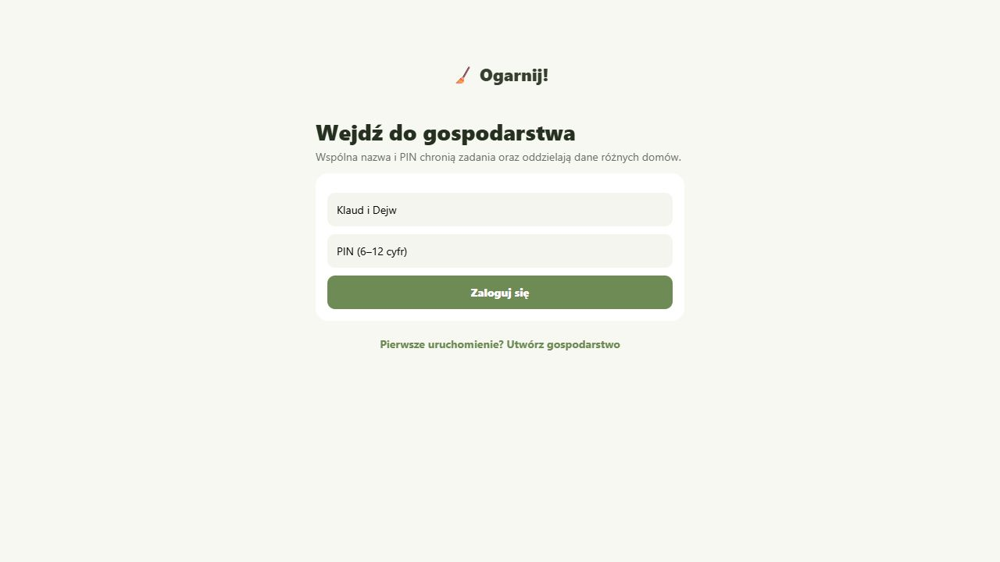
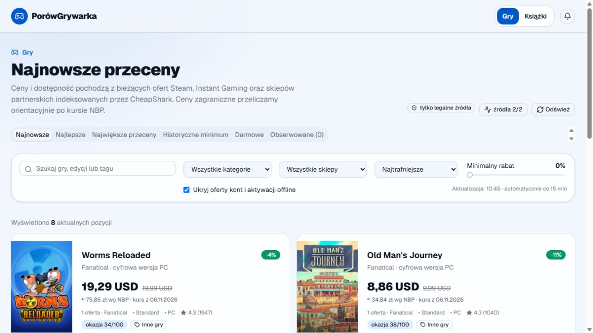
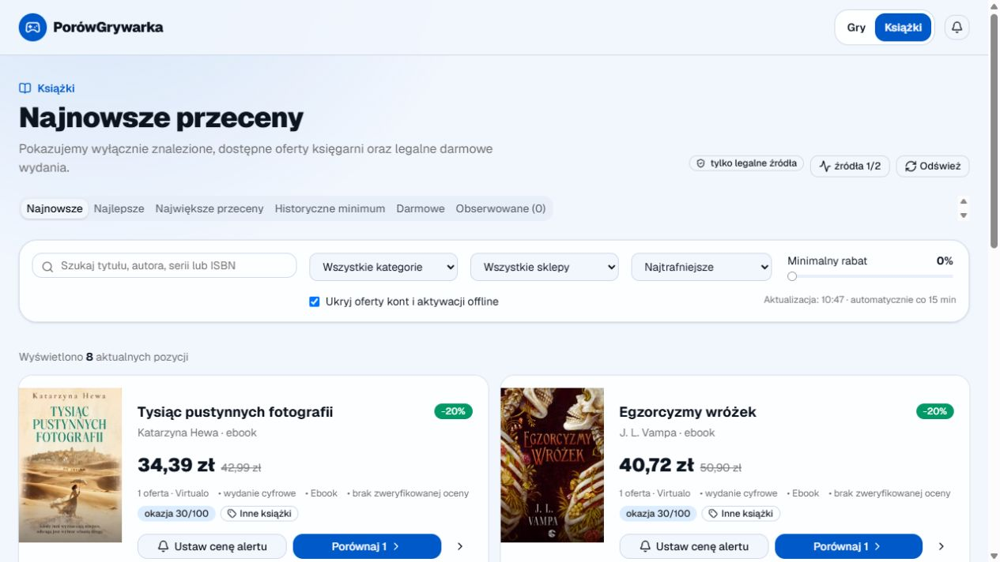
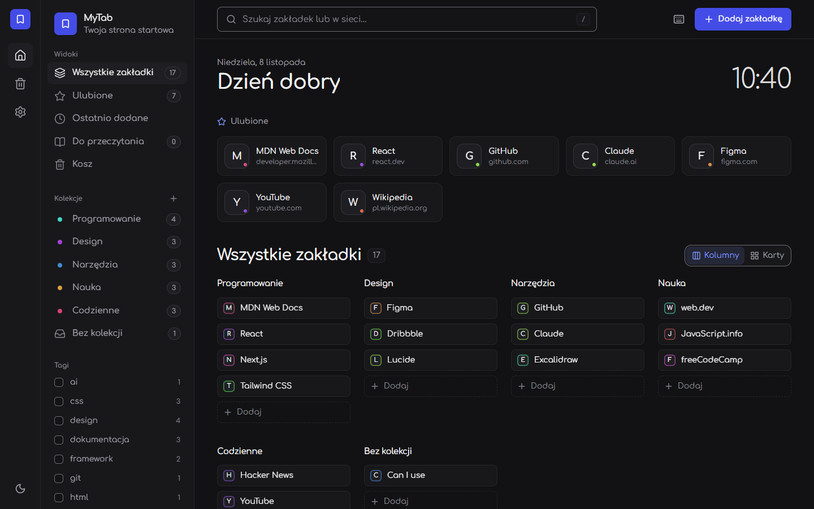
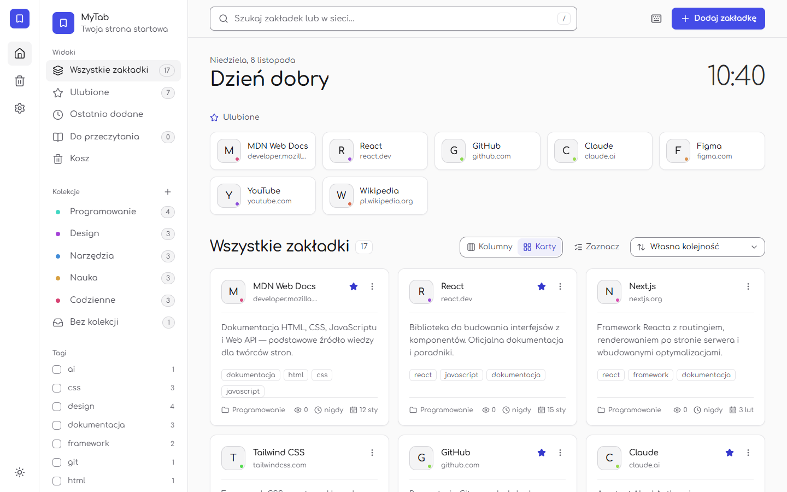
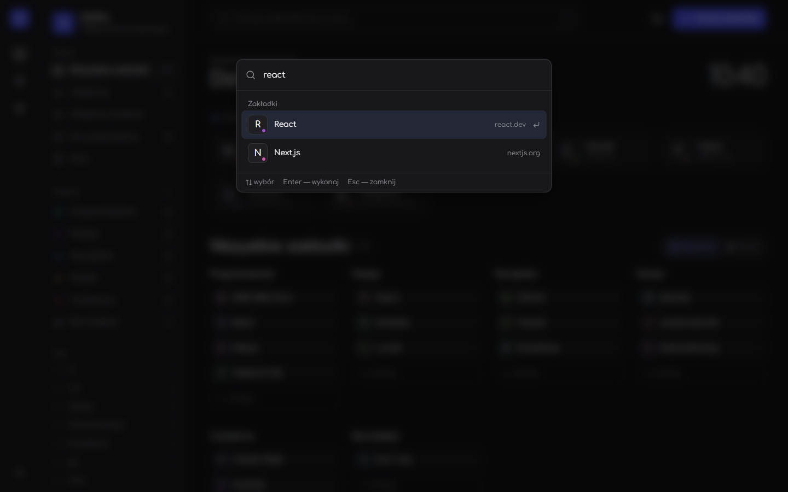
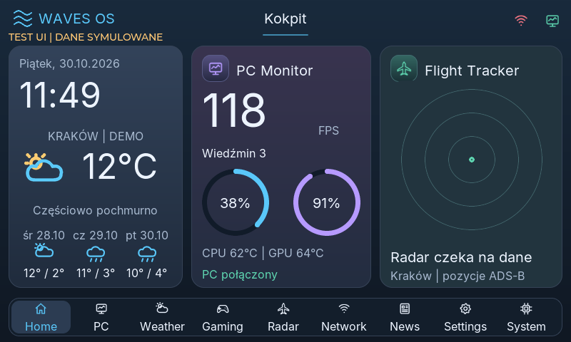
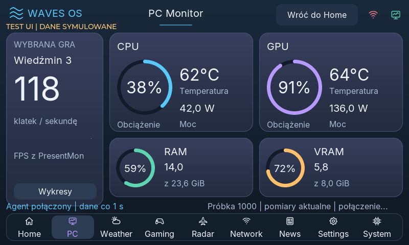
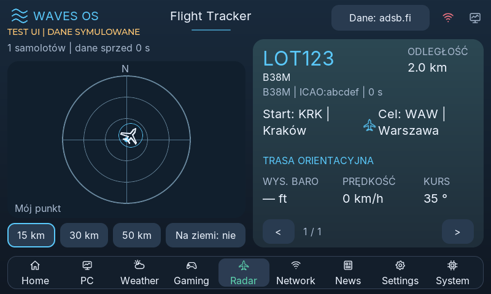

<!-- cms-status: published -->
<!-- cms-tags: ["ai","technologie","życie"] -->
<!-- cms-seo: {"title":"","description":"","image":"","canonical":"","robots":"index,follow","twitterCard":"summary_large_image"} -->

Dzień dobry. Żyję. Blog też żyje, chociaż patrząc na częstotliwość publikacji, można było już zacząć sprawdzać, czy domena nie jest do sprzedania.

Ostatni wpis zakończyłem stwierdzeniem, że teraz wypadałoby w końcu zacząć regularnie pisać. Miałem własny CMS, newsletter, komentarze i wszystkie możliwe narzędzia do tego, żeby usiąść i wyprodukować kolejnego internetowego wysrywa. Wszystko gotowe. Żadnych wymówek.

No i od sierpnia mamy listopad.

Co się wydarzyło? Otóż po zbudowaniu narzędzia do pisania odkryłem, że można budować również inne narzędzia. Do sprzątania, szukania promocji, porządkowania zakładek i sprawdzania, co mi właśnie przelatuje nad głową. A potem jeszcze postawić sobie lokalną sztuczną inteligencję, żeby mieć komu opowiadać o kolejnych pomysłach.

Także ten. Regularność na poziomie polskiego pociągu w pierwszym dniu opadów śniegu. Ale przynajmniej mam co opisywać.

<!-- more -->

## Najpierw trzeba było Ogarnąć!

Zacznijmy od spraw przyziemnych. Dosłownie, bo od podłogi, kurzu i kibla.

Mamy mieszkanie, mamy dwie osoby i mamy czynności, które należy wykonywać niezależnie od tego, jak bardzo człowiek wolałby akurat pograć. Normalnie robi się listę, dzieli obowiązki i sprząta. Ja stwierdziłem, że potrzebujemy aplikacji.

Tak powstało **Ogarnij!** Nazwa krótka, treściwa i pasująca zarówno do mieszkania, jak i do autora tego bloga.

Apka układa harmonogram dla naszego 57-metrowego królestwa. Pokazuje, co jest do zrobienia dzisiaj, kto ma to zrobić i ile mniej więcej powinno to zająć. Są daty, plan tygodnia, odhaczanie zadań i wyniki. Większe porządki kręcą się w siedmiotygodniowym cyklu, żeby piekarnik nie czekał na czyszczenie do kolejnej przeprowadzki.

I najważniejsze: stan synchronizuje się między telefonami. Czyli jak coś odhaczę, to drugi telefon też o tym wie. Nie trzeba organizować konferencji prasowej pod tytułem „zobacz, umyłem zlew”. System przyjął. Zasługi udokumentowane.

Jedna zasada jest niezmienna: WC zawsze moje. Mogę sobie napisać generator harmonogramu, synchronizację i bazę danych w chmurze, ale tego przydziału żadnym algorytmem nie przeskoczę. Informatyka ma swoje granice.

Najbardziej absurdalne jest to, że planowanie sprzątania potrafi mnie wciągnąć na dłużej niż samo sprzątanie. W aplikacji przesuniesz przycisk, dodasz filtr, poprawisz datę i masz satysfakcję. Kurz, niestety, nie znika od udanego deploymentu. Sprawdzałem.

## PorówGrywarka, czyli oszczędzanie z własnym zapleczem informatycznym

Drugi projekt dotyczy dziedziny, w której mam wyjątkowo dużo samozaparcia: szukania kolejnej gry, na którą później nie będę miał czasu.

Mógłbym po prostu wejść do sklepu. Ale skoro można przy okazji napisać **PorówGrywarkę**, to przecież szkoda zmarnować taki potencjał do komplikowania sobie życia.

To agregator cen gier i książek. Wyszukuje oferty w zewnętrznych źródłach, zbiera je w jednym miejscu i próbuje dopasować te dotyczące tego samego produktu. Gry korzystają między innymi ze Steam, Instant Gaming i CheapShark, książki mają osobne integracje z księgarniami. Ceny zagraniczne są orientacyjnie przeliczane na złotówki po kursie NBP.

Brzmi jak „pobierz cenę i pokaż cenę”, prawda?

No to teraz dorzućcie różne wydania, tytuły zapisane na kilka sposobów, literówki, niedostępny sklep i promocję, która zdążyła zniknąć, zanim człowiek skończył się nią ekscytować. Nagle ta jedna liczba z końcówką „zł” ma za sobą więcej roboty niż niejeden raport w korpo.

 
Są filtry, sortowanie, obserwowane pozycje, ustawianie progów alertów i widoki przecen. Jest też historia cen, która z natury potrzebuje czasu, żeby się zapełnić. Żaden wykres nie powinien udawać, że obserwował grę przez ostatni rok, jeśli dopiero co zaczął zbierać dane. Dostarczanie alertów ma jeszcze swoje zależności od konfiguracji, więc nie ogłaszam tutaj, że każdy telefon i każda skrzynka mailowa już będą trąbić o promocjach.

Książki dostały własną sekcję. Żeby człowiek mógł mieć zaległości kulturalne w więcej niż jednym formacie.

Całość nadal rozwijam. Sklepy potrafią nie odpowiedzieć, źródła mają ograniczenia, a końcową cenę trzeba sprawdzić u sprzedawcy. Ale apka działa i możecie ją zobaczyć [tutaj](https://porowgrywarka.dave-pytel.workers.dev).

Czy oszczędziłem dzięki temu czas? Na etapie budowania — kurwa, absolutnie nie. Czy mnie to bawiło? Bardzo.

## MyTab, czyli porządek w zakładkach metodą „napisz sobie program”

Skoro już ogarniamy mieszkanie i ceny, wypadałoby ogarnąć również przeglądarkę.

Wiecie, jak to jest z zapisywaniem stron. To przeczytam później. To mi się przyda. Tu jest fajny poradnik. A tutaj narzędzie, którego nazwy za godzinę nie będę pamiętał. Po pewnym czasie masz prywatne muzeum dobrych intencji i ani jednej sensownej wskazówki, gdzie czego szukać.

No więc powstał **MyTab** — własna strona startowa i menedżer zakładek.

 
*MyTab w widoku kolumn. Na zrzutach są przykładowe zakładki przygotowane do prezentacji aplikacji.*

Są kolekcje i podkolekcje, tagi, ulubione, notatki oraz „Do przeczytania”. Można przeciągać, przenosić, wyszukiwać i sprzątać duplikaty. Wyszukiwarka radzi sobie także z częścią literówek, bo dobrze, żeby przynajmniej mój własny program nie obrażał się na mnie za źle wpisaną nazwę biblioteki.

Do tego import zakładek z przeglądarki i eksport, żeby nie trzeba było przepisywać swojego internetowego dobytku ręcznie. Usunięte rzeczy trafiają do kosza. Takiego cyfrowego, który w przeciwieństwie do tego w kuchni potrafi opróżnić się sam.

Oczywiście sam ciemny motyw nie wystarczył. Jest też jasny, są różne akcenty i dwa sposoby oglądania zakładek. Wiecie, te fundamentalne decyzje życiowe: kolumny czy karty? Człowiek ma ważniejsze sprawy, ale najwyraźniej akurat nie ja.

*Wariant dla tych, którzy chcą widzieć swoje zaległości również za dnia.*

A pod `Ctrl+K` jest paleta poleceń. Można szybko znaleźć zakładkę, kolekcję albo akcję. Mała rzecz, ale jak już się człowiek przyzwyczai, to zaczyna wciskać ten skrót wszędzie i dziwić się, że lodówka nie reaguje.

Podstawowe dane są zapisywane lokalnie w przeglądarce. Jest też wersja dodatku zastępującego nową kartę, z zapisywaniem stron z paska narzędzi i menu kontekstowego. Nie będę udawał, że zrobienie widocznej na ekranie karty automatycznie oznacza załatwienie całej drogi publikacji dodatku w każdym sklepie. To osobna zabawa.

Wersję internetową możecie sprawdzić [tutaj](https://mytab.dave-pytel.workers.dev).

Czyli tak: miałem bałagan w zakładkach. Teraz mam menedżer zakładek, dodatek do przeglądarki i kolejny projekt do utrzymania. Porządek musi kosztować.

## A potem mały ekran dostał własne środowisko

Przy aplikacjach przeglądarkowych można przynajmniej zamknąć kartę i udawać, że problem nie istnieje. Ze sprzętem jest gorzej, bo stoi na biurku i patrzy.

Mam siedmiocalowy ekran dotykowy Waveshare z ESP32-S3. Zaczynaliśmy od uruchamiania wyświetlacza, dotyku i Wi-Fi, a jednym z głównych pomysłów był Flight Tracker. Własny ekran z informacją o samolotach w okolicy. Nerdowskie? Owszem. Właśnie dlatego mnie to zainteresowało.

Tyle że w którymś momencie sam tracker przestał mi wystarczać. Skoro już stoi ekran, to przecież może pokazywać również komputer. Pogodę. Premiery gier. Wiadomości.

I tak powstał **WAVES OS**.

*Podgląd interfejsu z symulatora Windows, ze wspólnego kodu UI. Widoczne dane demonstracyjne nie są pomiarem komputera ani pogodą z chwili czytania wpisu.*

Nazwa brzmi dumnie, ale dla porządku: nie napisałem własnego Windowsa. To natywne środowisko aplikacji dla mikrokontrolera. Bez Linuxa i Androida. Interfejs, obsługa urządzenia i usługi, które muszą się zmieścić na tej małej płytce i ze sobą współpracować.

W aktualnej wersji jest PC Monitor z telemetrią i FPS, pogoda, Gaming z kalendarzem premier, Network, News z zapisem artykułów na kartę SD i radar lotów. Po stronie Windowsa działa agent wysyłający dane przez sieć lokalną.

*Ekran PC Monitora w symulatorze. Dane są symulowane; rzeczywista dostępność FPS zależy od gry i możliwości pomiaru.*

Największy przeskok? Aktualizacje bezprzewodowe. Z podpisywaniem obrazu i możliwością powrotu do poprzedniej wersji, jeśli nowa nie wstanie jak należy. Przy ekranie zamkniętym w obudowie to znacznie ciekawszy wynalazek niż kolejna okazja do rozkręcania całego ustrojstwa.

To już działa na urządzeniu, a nie tylko na ładnym obrazku. Co oczywiście nie oznacza, że skończyły się rzeczy do poprawiania. Sprzęt potrafi się zawiesić, sieć potrafi zrobić sobie wolne, a ja potrafię uznać, że ikona powinna być jednak odrobinę bardziej w lewo. Każde z nas wnosi coś od siebie.

## Samoloty też się załapały

Flight Tracker nie wyleciał z projektu. Wylądował w WAVES OS jako osobna aplikacja z radarem.

Można oglądać pozycje samolotów, wybrać zasięg i zajrzeć do szczegółów lotu. Przy trasach trzeba zachować zdrowy rozsądek — orientacyjna informacja pozostaje orientacyjną informacją, a nie komunikatem od kontrolera ruchu.

*Zrzut testowego widoku z symulowanym lotem. To prezentacja działania interfejsu, nie zapis prawdziwego przelotu LOT123.*

Jest coś bardzo przyjemnego w tym, że zaczynasz od czarnego ekranu i zastanawiania się, dlaczego nie chce się zaświecić, a później masz na nim własny radar. Po drodze człowiek zaprzyjaźnia się z ustawieniami pamięci, bibliotekami i komunikatami błędów, których nigdy nie zamierzał poznawać. Edukacja przez upór. Polecam, chociaż nie wiem komu.

## W międzyczasie próbowałem zmieścić sztuczną inteligencję w karcie graficznej

Jakby aplikacji i elektroniki było mało, do kompletu doszły lokalne modele AI. Ollama, Open WebUI, sprawdzanie różnych modeli i kombinowanie, jak zrobić sobie pomocnika do kodowania.

W poprzednim wpisie o sprzęcie zachwycałem się RTX-em 5060 Ti. Nadal go lubię. Tylko że osiem gigabajtów pamięci graficznej potrafi bardzo stanowczo sprowadzić człowieka na ziemię, kiedy ten uzna, że odpali sobie większy model.

Model się pobiera. Człowiek czeka. Model próbuje się załadować. Człowiek już układa w głowie listę projektów, które zaraz zrobi.

Brak pamięci.

No i chuj, znowu zamiast kodowania jest zarządzanie oczekiwaniami. Własnymi.

Były testy Qwenów, Hermesa i innych modeli, dobieranie kontekstu, sprawdzanie podziału pracy między procesor a kartę oraz poszukiwanie konfiguracji, która daje użyteczne odpowiedzi i nie kończy się kolejnym błędem. Potem narzędzia do pracy na plikach, Cline, OpenCode i dalsze pomysły na własnego FORGE'a.

Nie wszystko wyszło za pierwszym razem. Nie wszystko wyszło w ogóle. Ale coraz lepiej rozumiem, gdzie kończy się „o, ale fajnie odpowiada”, a zaczyna „dobra, teraz spróbujmy zrobić z tym coś konkretnego”. No i mam chyba 7 spersonalizowanych agentów, każdy do innego zadania, każdy z własnymi instrukcjami. I siedzi mi to jak jakiś Poltergeist w bebechach mojego hardware'u i udaje, że jest mądre. Ale jest moje, lokalne i nie wychodzi ani pół bita na jakikolwiek serwer.

## Sam tego wszystkiego nie wystukałem

Nie będę tutaj budował legendy samotnego geniusza, który zamknął się na trzy miesiące w gabinecie i wyszedł z własnym ekosystemem aplikacji. W dużej części tej roboty pomagało mi AI. ChatGPT, Codex i kolejne narzędzia, które sprawdzałem po drodze.

Ja przynosiłem problem, podstawowy kod, pomysł i zwykle całkiem pokaźną listę uwag. AI pomagało z kodem, opierdalało niemiłosiernie za mieszanie funkcji, błędną składnię, nieistniejące komendy i ogólnie plusik za chęci, błędami i rzeczami, których jeszcze nie umiałem sensownie poukładać. Potem uruchamianie, testowanie, patrzenie, co nie działa, i następna runda.

Samo „wygeneruj mi aplikację” nigdy nie kończy tematu. Zaczyna go. Bo ktoś musi zauważyć, że zły dzień wyświetla się w harmonogramie, oferta dotyczy innego wydania, przycisk zasłania tekst, a ekran po aktualizacji robi za kosztowną czarną prostokątną dekorację.

I właśnie to dłubanie mnie wciągnęło. Masz jakiś własny, niewielki problem, a po kilku podejściach używasz czegoś, co wcześniej istniało wyłącznie w twojej głowie. Nawet jeśli po drodze wyklinacie się z komputerem w trzech językach. I niekoniecznie jest to Python czy react.

## Czyli gdzie byłem, kiedy mnie nie było?

Tutaj. Przy biurku. Tylko zamiast otwierać edytor wpisów, otwierałem kolejny projekt.

Zrobiłem sobie narzędzie do pisania i przez kolejne miesiące zajmowałem się wszystkim dookoła. Teraz mam apkę do domowych obowiązków, porównywarkę cen, własną stronę startową przeglądarki i środowisko na mały ekran. Do tego katalog modeli AI i wystarczająco dużo pomysłów, żeby znowu nie napisać nic do Wielkanocy.

I chyba właśnie dlatego warto było w końcu usiąść do tego tekstu. Bo każda z tych rzeczy zasługuje na własną historię. Nie tylko pokazanie gotowego widoku, ale też opis tego, co się po drodze rozjebało i dlaczego mimo wszystko chciałem do tego wracać.

Nie będę ponownie obiecywał regularności, bo ostatnia deklaracja ma tutaj wystarczająco mocne dowody przeciwko sobie.

Na dzisiaj: wróciłem, mam o czym pisać i tym razem udało mi się nawet skończyć wpis.

Teraz tylko go opublikować. Bez dorabiania nowej funkcji w CMS-ie.

Do następnego!